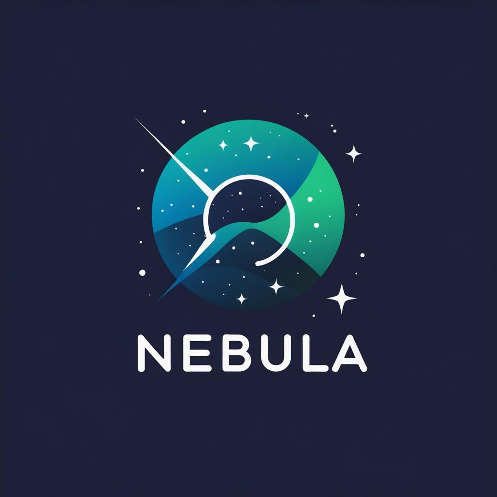

<div align="center">
  

  **Template-driven FPGA build tool for Vivado — with automatic SystemVerilog dependency resolution.**

  [](https://www.rust-lang.org/)
[](https://en.wikipedia.org/wiki/SystemVerilog)
[](https://www.xilinx.com/products/design-tools/vivado.html)
[](LICENSE)
</div>

Nebula generates and runs a Vivado project from a single top module. You give it a top file, a part, and where your RTL lives; it figures out **which source files the design actually needs**, renders them into a Vivado TCL project, and (optionally) drives synthesis, implementation, and bitstream generation.

## How it works

1. **Dependency resolution.** Nebula links [**sv-tree**](https://github.com/Atlantix-EDA/sv-tree) — its dependency-resolution engine — which parses your SystemVerilog with `sv-parser` and walks the design hierarchy from the top module, following module instantiations *and* package imports, to produce the exact set of required files. No hand-maintained file lists. sv-tree is compiled directly into nebula, so nebula remains a single self-contained binary with no runtime tool to install.
2. **Template rendering.** The resolved file list, plus the part, constraints, IP, and any block-design TCL, is rendered into a Vivado TCL project via a [Tera](https://tera.netlify.app/) template.
3. **Vivado.** Nebula runs the generated TCL in batch mode, optionally compiling and/or opening the GUI.

The payoff: the files Vivado compiles always match what the RTL instantiates — change the design, and the build follows automatically.

## Installation

**Prerequisites:** Rust (stable). sv-tree is pulled in as a Cargo dependency — nothing else to install.

```bash
# Install from source
cargo install --git https://github.com/Atlantix-EDA/nebula

# Or clone and build locally
git clone https://github.com/Atlantix-EDA/nebula
cd nebula
cargo build --release      # binary at target/release/nebula
```

## Quick start

Point nebula at the top file and the root of your RTL:

```bash
nebula \
  --proj-name KINTEX_KU060 \
  --top-file  hw/rtl/top/top_level_kintex.sv \
  --source-dir hw/rtl \
  --part xcku060-ffva1156-2-i \
  --target-dir ~/builds/kintex
```

To see what nebula resolves without generating a project, add `--list-files`:

```bash
nebula --proj-name KINTEX_KU060 \
       --top-file hw/rtl/top/top_level_kintex.sv \
       --source-dir hw/rtl --part xcku060-ffva1156-2-i \
       --target-dir ~/builds/kintex \
       --list-files
```

```
[INFO] Resolving SystemVerilog dependencies via sv-tree...
[INFO] Resolved 8 source files (5 unresolved)

# Dependency resolution (sv-tree)
  required files: 8
    .../clock_control/system_clock_reset.sv
    .../peripherals/led_control.sv
    .../peripherals/user_inputs_sync.sv
    .../synchronization/sync2ff.sv
    .../timers/SystemPkg.sv
    .../timers/counter_xy.sv
    .../timers/reset_counter.sv
    .../top/top_level_kintex.sv
  unresolved (5) — supply as IP / primitive / block-design wrapper:
    BUFG
    IBUFDS
    MMCME3_BASE
    MMCME4_BASE
    blazeSystem_wrapper
```

Names nebula can't find in the source tree (Xilinx primitives, vendor IP, block-design wrappers generated outside the RTL) are **reported, not silently dropped** — supply them with `--ip` / `--include-tcl` as needed.

## Command reference

```bash
nebula [OPTIONS]
```

**Required**

| Flag | Description |
|------|-------------|
| `--proj-name <NAME>` | Vivado project name |
| `--target-dir <PATH>` | Where to create the Vivado project |
| `--part <PART>` | FPGA part (e.g. `xcku060-ffva1156-2-i`) |

**Sources**

| Flag | Description |
|------|-------------|
| `--top-file <FILE>` | Top-level `.sv`; enables automatic dependency resolution |
| `--source-dir <DIR>` | Root(s) to search for dependencies (repeatable) |
| `--constraints <FILE>` | XDC constraint file (repeatable) |
| `--ip <FILE>` | Xilinx IP `.xci` to import (repeatable) |
| `--include-tcl <FILE>` | Extra TCL to `source` — e.g. a block-design script (repeatable) |
| `--elf-file <FILE>` | ELF for an embedded (MicroBlaze) processor |

**Execution**

| Flag | Description |
|------|-------------|
| `--compile` | Run synthesis, implementation, and bitstream |
| `--open-gui` | Open the Vivado GUI after the TCL runs |
| `--list-files` | Print the resolved file set and exit (no Vivado) |
| `--init-template` | Write a starter `Justfile` into the target directory |

## Template variables

The bundled Tera template receives these:

| Variable | Description |
|----------|-------------|
| `proj_name` | Project name |
| `part` | FPGA part |
| `target_dir` | Build directory |
| `origin_dir` | First `--source-dir` (backward-compatible alias) |
| `source_dirs` | All `--source-dir` values |
| `sv_files` | Resolved source files (from sv-tree) |
| `sv_file_count` | Number of resolved files |
| `constraints_files` | `--constraints` values |
| `ip_files` | `--ip` values |
| `include_tcl_files` | `--include-tcl` values |
| `elf_path_file` | `--elf-file` value |
| `compile` / `open_gui` | Execution flags |

## Why Nebula

- **No manual file lists.** The build set is derived from the source, so it can't drift out of sync with the RTL.
- **Single binary.** Rust, self-contained, sv-tree compiled in — no Python/Node runtime, no external tools.
- **Reproducible.** Same inputs → same Vivado project.
- **Composable.** Constraints, IP, and block-design TCL are wired in through explicit flags.

---

*Point it at your top. Nebula finds the rest.*
